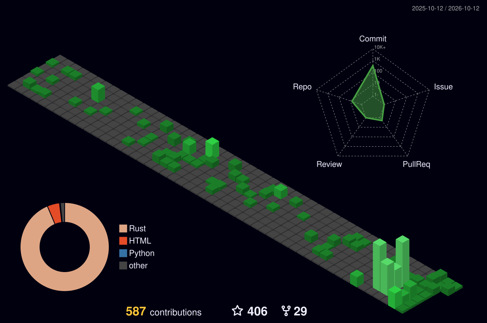

<div align="center">
  <a href="https://github.com/thunderkex">
    
  </a>

  <p align="center" style="max-width:600px;">
    
    I write code for the web, Android, and whatever hardware is nearby — mostly backend and automation, occasionally firmware.
    <br/>
    
    Open to collaboration on things that are actually interesting — IoT, custom Android builds, weird infra problems.
  </p>
</div>

<br/>

<div align="center">

 <b>Stack</b>

<br/><br/>


</div>

<br/>

<div align="center">

 <b>GitHub Stats</b>

<br/><br/>


</div>

<!--START_SECTION:waka-->


**I'm an Early 🐤** 

```text
🌞 Morning                2735 commits        ██████████████░░░░░░░░░░░   57.82 % 
🌆 Daytime                1943 commits        ██████████░░░░░░░░░░░░░░░   41.08 % 
🌃 Evening                3 commits           ░░░░░░░░░░░░░░░░░░░░░░░░░   00.06 % 
🌙 Night                  49 commits          ░░░░░░░░░░░░░░░░░░░░░░░░░   01.04 % 
```
📅 **I'm Most Productive on Monday** 

```text
Monday                   1117 commits        ██████░░░░░░░░░░░░░░░░░░░   23.62 % 
Tuesday                  990 commits         █████░░░░░░░░░░░░░░░░░░░░   20.93 % 
Wednesday                679 commits         ████░░░░░░░░░░░░░░░░░░░░░   14.36 % 
Thursday                 887 commits         █████░░░░░░░░░░░░░░░░░░░░   18.75 % 
Friday                   829 commits         ████░░░░░░░░░░░░░░░░░░░░░   17.53 % 
Saturday                 144 commits         █░░░░░░░░░░░░░░░░░░░░░░░░   03.04 % 
Sunday                   84 commits          ░░░░░░░░░░░░░░░░░░░░░░░░░   01.78 % 
```


📊 **This Week I Spent My Time On** 

```text
🕑︎ Time Zone: Asia/Jakarta

💬 Programming Languages: 
Markdown                 6 hrs 34 mins       ██████░░░░░░░░░░░░░░░░░░░   25.13 % 
Java                     4 hrs 58 mins       █████░░░░░░░░░░░░░░░░░░░░   19.00 % 
PHP                      3 hrs 7 mins        ███░░░░░░░░░░░░░░░░░░░░░░   11.92 % 
TypeScript               1 hr 50 mins        ██░░░░░░░░░░░░░░░░░░░░░░░   07.01 % 
YAML                     1 hr 49 mins        ██░░░░░░░░░░░░░░░░░░░░░░░   06.95 % 

💻 Operating System: 
Windows                  26 hrs 11 mins      █████████████████████████   100.00 % 
```

**I Mostly Code in JavaScript** 

```text
JavaScript               9 repos             ██████░░░░░░░░░░░░░░░░░░░   23.68 % 
Rust                     3 repos             ██░░░░░░░░░░░░░░░░░░░░░░░   07.89 % 
PHP                      3 repos             ██░░░░░░░░░░░░░░░░░░░░░░░   07.89 % 
Kotlin                   3 repos             ██░░░░░░░░░░░░░░░░░░░░░░░   07.89 % 
TypeScript               1 repo              █░░░░░░░░░░░░░░░░░░░░░░░░   02.63 % 
```


 Last Updated on 29/10/2026 05:12:30 UTC
<!--END_SECTION:waka-->

<div align="center">

<details>
<summary>
  
  <b>Contribution activity</b>
</summary>

<br/>


<a href="./profile-3d-contrib/profile-night-green.svg">
  
</a>

</details>

</div>
